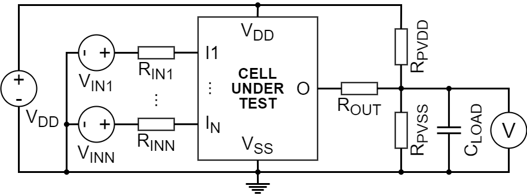

# Simulation

## Running the simulation

Run the SPICE simulation via `python3 ToolSpiceToSimulationData.py`.
The simulation requires a configuration for the cell library in JSON format, and a configuration for the fault and testbench parameters in JSON format.
Use `python3 ToolSpiceToSimulationData.py --help` to get a list of all command line arguments.
Below is an example that simulates three fault types for the BUF cell:

```bash
python3 ToolSpiceToSimulationData.py \
    --library Configurations/generic.jsonc \
    --library-path $(realpath ../cell-libraries) \
    --output $(realpath ../fault-models) \
    --output-compress \
    --cells "^BUF$" \
    --inputs "static transition" \
    --faults "stuck-at open bridge" \
    --processes 32 \
    --debug \
        export-plan \
        export-testbench \
        export-simulation \
        export-measurement \
        plot-simulation \
        plot-measurement \
    --verbose
```

The tool performs the following steps in order:

1. Simulations are planned and a full to-do list of simulations is created.
2. Simulations are run in parallel to create simulation data
   1. A testbench is created for the cell and optionally a fault is injected
   2. The testbench is simulated via a SPICE simulator (ngspice)
   3. The SPICE result is measured and simulation data is derived
3. All the simulation data is combined and exported (**raw simulation data, not a fault model**)
   1. Simulated and measured cell behaviour in `simulation.data.json`
   2. Simulation status and validation status in `simulation.status.json`

## Simulation Data

The exported simulation data contains all measurement results that have been performed, inluding the liberty-model and fault-free data.
This simulation data will be used to subsequently build a fault model.
Below is a shortened version of the generated data file:

```json
"liberty-model": {
    "BUF": {
        "liberty-model": [
            { "id": -1, "inputs": { "IN1": "0" }, "outputs": { "OUT": "0" } },
            { "id": -1, "inputs": { "IN1": "1" }, "outputs": { "OUT": "1" } },
            ...
        ]
    }
},
"fault-free": {
    "BUF": {
        "fault-free": [
            { "id": 0, "inputs": { "IN1": "0" }, "outputs": { "OUT": "0" } },
            { "id": 1, "inputs": { "IN1": "1" }, "outputs": { "OUT": "1" } },
            ...
        ]
    }
},
"stuck-at": {
    "BUF": {
        "stuck-at 1 IN1": [
            { "id": 4,  "inputs": { "IN1": "0" }, "outputs": { "OUT": "1" } },
            { "id": 8, "inputs": { "IN1": "1" }, "outputs": { "OUT": "1" } },
            ...
        ]
    }
}
```

## Simulation Status

The status data contains the information on every simulation.
Below is an excerpt, which shows that all four jobs for the fault-free version were simulated, and the fault-free result matched the liberty equations.
A warning of premature simulation exit indicates that gmin stepping was unsuccessfull and the SPICE simulation was halted.
This happens in case of unstable cell behavior during a fault.
The parameter `gmin` can be increased in the configuration to limit the number of aborted simulations in trade of simulation accuracy.
If an error is included in the output, then the SPICE simulation was unsuccessfull and the problem should be investigated.

```json
"BUF": {
    "fault-free": [
        "job 0 simulated",
        "job 1 simulated",
        "job 2 simulated",
        "job 3 simulated",
        "validated"
    ],
    "stuck-at 1 IN1": [
        "job 4 simulated",
        "job 8 simulated",
        "job 12 simulated",
        "job 16 simulated"
    ],
    ...
    "bridge M1:drain and M19:drain": [
        "job 251754 simulated",
        "job 255170 simulated",
        "job 258586 simulated",
        "job 262002 simulated",
        "job 265418 simulated",
        "job 268834 simulated",
        "job 272250 simulation warning: aborted prematurely, assuming instability",
        "job 275666 simulation warning: aborted prematurely, assuming instability"
    ]
    ...
    "...": [
        "job XYZ spice error: SOME EXCEPTION",
        "job XYZ measure error: SOME EXCEPTION"
    ]
}
```

## Fault Injection

Faults are injected by modifying the cell model, inserting resistors and modifying connections.
These faults are meant to model defects that arise during production of the physical circuit.
The following faults are implemented at the moment:

- `stuck-at`: Stuck-at 0 or stuck-at 1 fault at the input or output of a cell, simulated via a small resistor to VDD or VSS.
- `open`: A pin of a transistor is disconnected, simulated via a big resistor between the transistor and the original connection.
- `bridge`: A pin of a transistor is connected to another pin, simulated via a small resistor to the other pin.
- `port-open`: An input or output of the cell is disconnected, simulated via a big resistor between the input or output and the original connection.
- `port-bridge`: An input or output of the cell is connected to another input / output, simulated via a small resistor to the other pin.
- `transistor-drive`: The transistor's channel does conduct less than normally, simulated via resistors on source and drain.
- `transistor-leak`: The transistor's channel does insulate less than normally, simulated via a resistor between source and drain.

The fault types `liberty-model` and `fault-free` are used for simulations that do not inject faults into the cell.
These simulations are required to validate a correct cell simulation (fault-free vs liberty-model) and then find fault propagations (faulty vs fault-free) to build a fault model.

- `liberty-model`: The equations given in the liberty specification are evaluated instead of simulating the SPICE cell.
- `fault-free`: The SPICE cell is simulated unmodified (without a fault).

To list all planned fault injections run the application with the `--debug export-plan finish-after-plan`.
The planned fault injections will be listed in the `plan.json` file.

## Testbench

The SPICE simulation uses a test bench which is automatically generated to simulate the cells with injected faults.
Use the `--debug export-testbench` option to export the generated testbenches, including the cell with injected faults.
The concept of a testbench is shown in the figure below.

A testbench contains voltage sources `Vin1` to `VinN` which apply input values to the cell under test.
Input resistors `Rin1` to `Rinx` simulate a non-ideal voltage source.
The output(s) of the cell going through an output resistor `Rout1` to `RoutN` to simulate a non-ideal current sink.
The load capacitor `Cload` simulates the gate capacitance of cells connected to this output.
The `Rpvss` and `Rpvdd` resistors pull the output value to 50% VDD if the output is not driven by the cell.
All outputs are measured and classified into 0 (low voltage), 1 (high voltage), X (undefined, in between low and high voltage).



### Debugging via NgSpice

To simulate exported SPICE testbenches manually via the command line run the following commands:

```bash
# Start ngspice with the filename of the testbench you exported
ngspice <filename>
run

# Run a transient simulation (use m,u,... for milliseconds, microseconds):
tran <timestep> <simulation length>

# Example: Run simulation for 10 milliseconds with resolution of 1 microsecond:
tran 1u 10m

# plot all voltages:
plot all

# plot one voltage at one node (the names of the nodes are shown after the transient simulation):
plot <node-name1

# plot voltage at multiple nodes (the names of the nodes are shown after the transient simulation):
plot <node-name1, <node-name2, <node-name3

# Exit ngspice
quit
```
